  <!-- Animated Terminal Banner -->
  

    

  <!-- Tech Stack -->
  

    
    &nbsp;&nbsp;
    
    &nbsp;&nbsp;
    
    &nbsp;&nbsp;
    
    &nbsp;&nbsp;
    
    &nbsp;&nbsp;
    
    &nbsp;&nbsp;
    
    &nbsp;&nbsp;
    
    &nbsp;&nbsp;
    
    &nbsp;&nbsp;
    
    &nbsp;&nbsp;
    
  

   

  <!-- Social & Contact Badges -->

<!-- Social & Contact Badges -->

  &nbsp;&nbsp;
  &nbsp;&nbsp;
  &nbsp;&nbsp;
  

---

### 🛠️ About Me

- 🧑‍💻 **Backend Developer** focused on server performance, API architecture, and database operations.
- ⚙️ Passionate about **low-level computing**, system processes, and optimizing workloads on Linux.
- 🛠️ Building utility packages like [HookBox](https://github.com/IL1RO3/hookbox) and Django tools.

 

<!-- GitHub Stats & Top Languages -->

  
  &nbsp;&nbsp;
  

